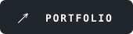
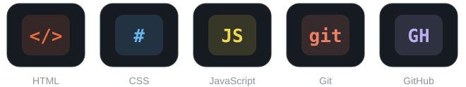
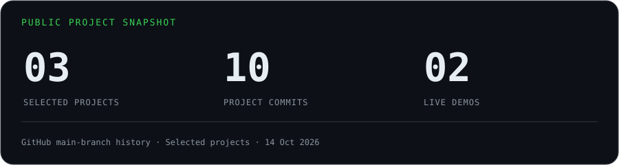
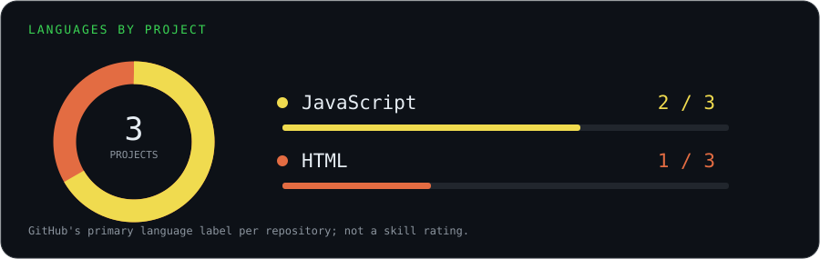
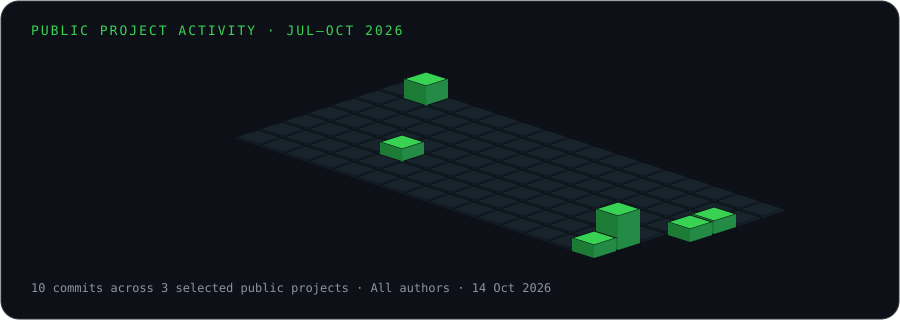
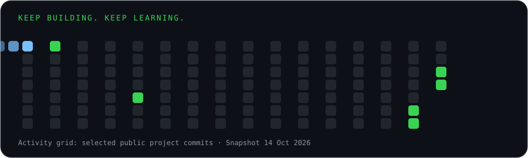

<div align="center">


<br>



<br>

<a href="https://syedkaifali96.github.io/kaif-web-demo/"></a>
<a href="https://www.linkedin.com/in/syed-kaif-ali-10b667430/"></a>
<a href="mailto:syedkaifali96@gmail.com"></a>

<br><br>

<sub>RESPONSIVE WEBSITES · BROWSER PROJECTS · KARACHI, PAKISTAN</sub>

</div>

---

## `~/` whoami

```console
student@karachi:~$ cat about.txt
```

I’m **Kaif**, a student web developer turning ideas into responsive websites with **HTML, CSS and JavaScript**.

- **Building:** my [personal portfolio](https://syedkaifali96.github.io/kaif-web-demo/) and small browser projects.
- **Learning:** mobile layouts, accessible interactions and clearer JavaScript.
- **Workflow:** AI-assisted implementation, followed by code review and checks.
- **Project experience:** personal and educational work, including a team project.
- **Languages:** English and Urdu.

<div align="center">

## `~/` toolbox



</div>

---

<div align="center">

## `~/` project pulse



<br><br>



## `~/` activity in motion



<br><br>



<sub>Public project snapshot: **14 October 2026**. Calendar and totals cover the three projects below, all authors on their default branches. Language counts use GitHub’s primary language labels; they are not proficiency scores.</sub>

</div>

---

## `~/` selected work

<a href="https://github.com/syedkaifali96/kaif-web-demo"></a>

[**Live website ↗**](https://syedkaifali96.github.io/kaif-web-demo/) · [Source](https://github.com/syedkaifali96/kaif-web-demo) · `HTML` `CSS` `JavaScript`

<a href="https://github.com/syedkaifali96/UninestPakistan"></a>

[**Source ↗**](https://github.com/syedkaifali96/UninestPakistan) · Educational team project

<a href="https://github.com/syedkaifali96/careswitch"></a>

[**Live prototype ↗**](https://syedkaifali96.github.io/careswitch/) · [Source](https://github.com/syedkaifali96/careswitch) · Personal student prototype

<sub>Project cards are illustrated previews. CareSwitch is an educational prototype.</sub>

---

## `~/` let's build

Interested in a **landing page**, **simple business website**, or **front-end update**?

Send your idea, required pages, content, deadline and estimated budget through my [portfolio contact form](https://syedkaifali96.github.io/kaif-web-demo/contact.html) or [LinkedIn](https://www.linkedin.com/in/syed-kaif-ali-10b667430/), and we can discuss the scope.

<div align="center">

`learn → build → review → improve`

</div>
