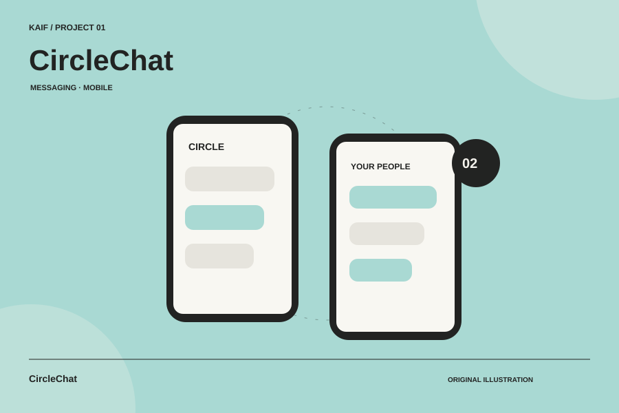
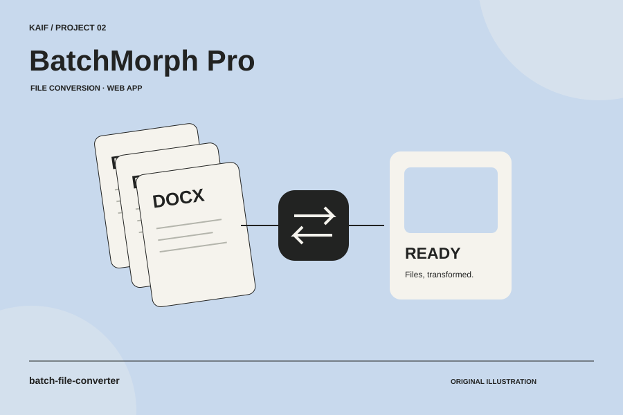
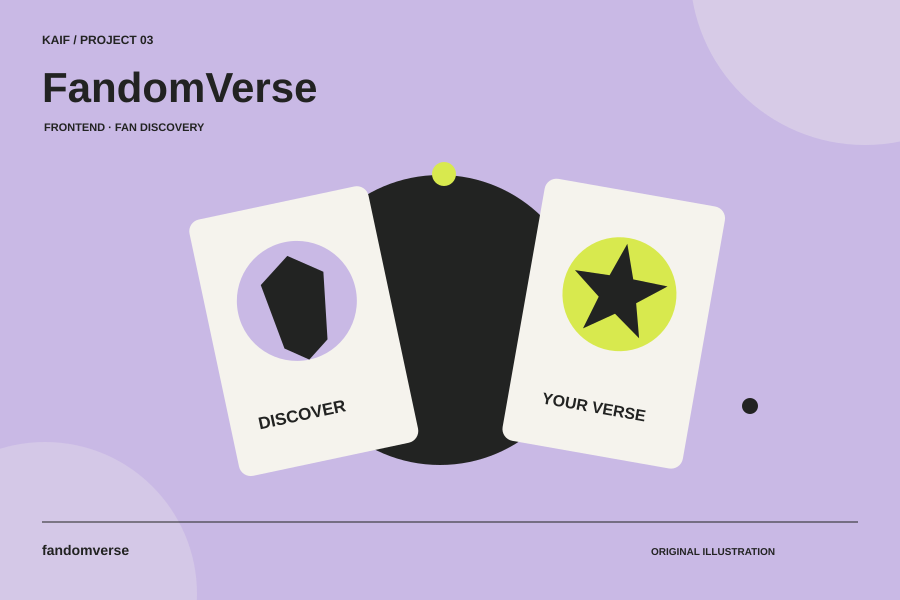
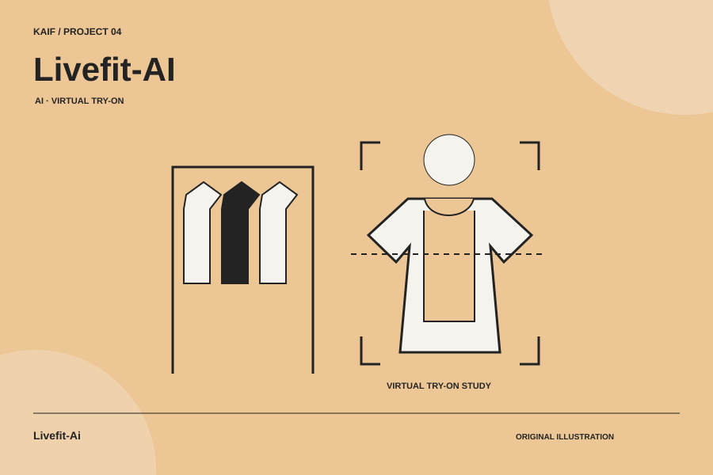
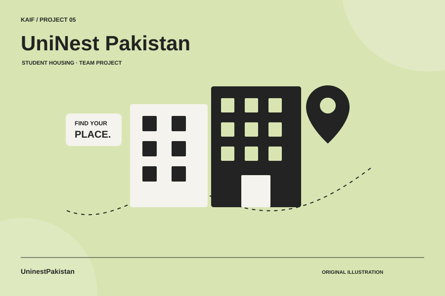
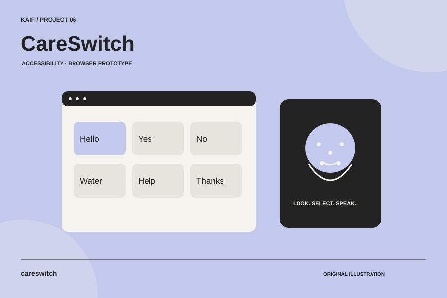
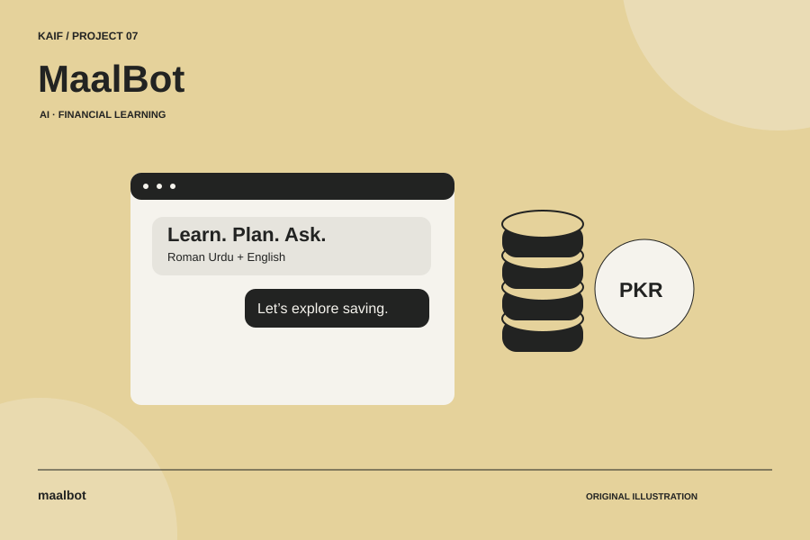

  

  <a href="https://syedkaifali96.github.io/kaif-web-demo/"><strong>Portfolio ↗</strong></a>
  &nbsp; · &nbsp;
  <a href="https://www.linkedin.com/in/syed-kaif-ali-10b667430/"><strong>LinkedIn ↗</strong></a>
  &nbsp; · &nbsp;
  <a href="mailto:syedkaifali96@gmail.com"><strong>Email ↗</strong></a>

## A little about me

I’m a student developer in **Karachi, Pakistan**, exploring web development, mobile apps and AI through projects. I care about clear layouts, useful interactions and learning by building.

I use AI tools to assist development, then review and refine the code. My work here includes **personal and educational projects**, and I keep learning through practice and feedback.

  

## Skills

- **Front-End:** HTML, CSS, JavaScript, UI/UX Design, Website Designing
- **Back-End & Database:** PHP, SQL, Database Management
- **Mobile:** Mobile App Development
- **AI:** AI Development & Integration
- **Tools:** Git, GitHub

## Projects to explore

Seven projects across web development, mobile apps and AI.

<table>
<tr>
<td width="50%" valign="top">

<h3>CircleChat</h3>

A small-circle messenger combining a mobile client, persistent conversations and real-time communication.

Expo · Fastify · Socket.IO · PostgreSQL

<strong>Private repository</strong> · Project summary

</td>
<td width="50%" valign="top">

<h3>BatchMorph Pro</h3>

Batch document and image conversion, with a React interface and server-side processing.

React · TypeScript · Node.js · PDF processing

<strong>Private repository</strong> · Project summary

</td>
</tr>
<tr>
<td width="50%" valign="top">

<h3>FandomVerse</h3>

A responsive fan discovery interface with navigation, search, authentication and cart interactions.

HTML · CSS · JavaScript · Bootstrap

<strong>Private repository</strong> · Project summary

</td>
<td width="50%" valign="top">

<h3>Livefit-AI</h3>

A research project exploring garment rendering, virtual try-on and generative AI workflows.

Virtual Try-On · Generative AI · Model research

<strong>Private repository</strong> · Project summary

</td>
</tr>
<tr>
<td width="50%" valign="top">

<h3>UniNest Pakistan</h3>

An educational team project for student hostel discovery, bookings and roommate finding in Pakistan.

Node.js · Express · SQLite

<a href="https://github.com/syedkaifali96/UninestPakistan"><strong>Source code ↗</strong></a>

</td>
<td width="50%" valign="top">

<h3>CareSwitch</h3>

A student communication-board prototype with phrase buttons, multilingual speech and optional head-control interactions.

JavaScript · Speech synthesis · Face landmarks

<a href="https://github.com/syedkaifali96/careswitch"><strong>Source code ↗</strong></a> &nbsp; · &nbsp; <a href="https://syedkaifali96.github.io/careswitch/">Live demo ↗</a>

</td>
</tr>
<tr>
<td width="50%" valign="top">

<h3>MaalBot</h3>

A conversational project exploring financial learning in Roman Urdu and English, with a savings calculator.

JavaScript · AI chatbot

<strong>Private repository</strong> · Project summary

</td>
<td width="50%"></td>
</tr>
</table>

All covers are original illustrations. Private projects are summaries; source access remains restricted. UniNest is an educational team project, CareSwitch is a student prototype, and Livefit-AI is a research experiment.

## How I approach a project

## Have a small website idea?

I’m interested in **landing pages**, **simple business websites** and **front-end content or layout updates**.

Send your idea, required pages, content, deadline and estimated budget through my [portfolio contact form](https://syedkaifali96.github.io/kaif-web-demo/contact.html) or [LinkedIn](https://www.linkedin.com/in/syed-kaif-ali-10b667430/), and we can discuss the scope.

**English · Urdu**
