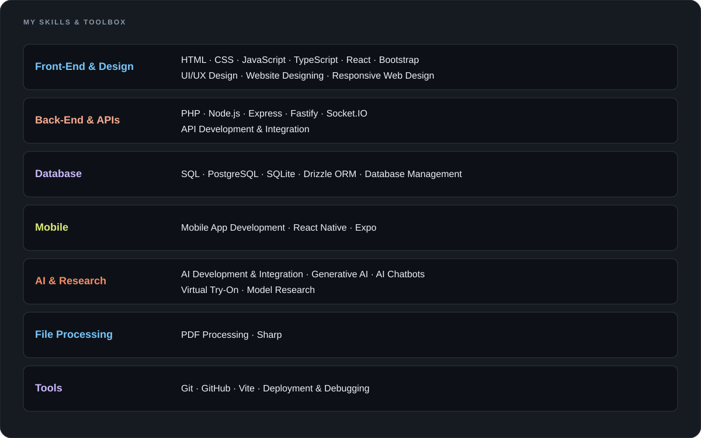
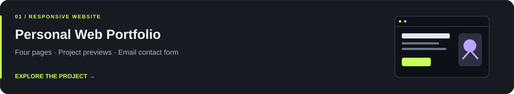
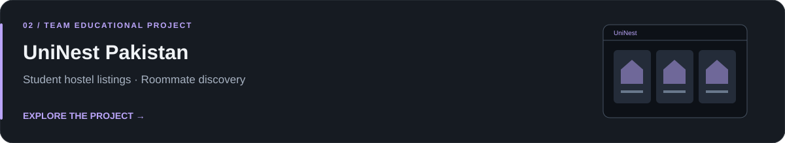
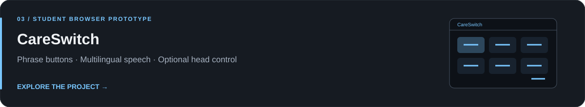
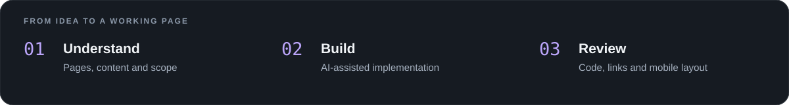

  

  <a href="https://syedkaifali96.github.io/kaif-web-demo/"><strong>Portfolio ↗</strong></a>
  &nbsp; · &nbsp;
  <a href="https://www.linkedin.com/in/syed-kaif-ali-10b667430/"><strong>LinkedIn ↗</strong></a>
  &nbsp; · &nbsp;
  <a href="mailto:syedkaifali96@gmail.com"><strong>Email ↗</strong></a>

## A little about me

I’m a student web developer in **Karachi, Pakistan**, building responsive websites and browser projects. My focus is clear layouts, mobile usability and useful interactions.

I use AI tools to assist development, then review and refine the code. My work here includes **personal and educational projects**, and I keep learning through practice and feedback.

  

## Skills

- **Front-End:** HTML, CSS, JavaScript, UI/UX Design, Website Designing
- **Back-End & Database:** PHP, SQL, Database Management
- **Mobile:** Mobile App Development
- **AI:** AI Development & Integration
- **Tools:** Git, GitHub

## Projects to explore

[**Open the website ↗**](https://syedkaifali96.github.io/kaif-web-demo/) · [Source code](https://github.com/syedkaifali96/kaif-web-demo)

[**Explore the source ↗**](https://github.com/syedkaifali96/UninestPakistan)

[**Try the prototype ↗**](https://syedkaifali96.github.io/careswitch/) · [Source code](https://github.com/syedkaifali96/careswitch)

Project cards are illustrated previews. UniNest is a team educational project; CareSwitch is a student prototype.

## How I approach a project

## Have a small website idea?

I’m interested in **landing pages**, **simple business websites** and **front-end content or layout updates**.

Send your idea, required pages, content, deadline and estimated budget through my [portfolio contact form](https://syedkaifali96.github.io/kaif-web-demo/contact.html) or [LinkedIn](https://www.linkedin.com/in/syed-kaif-ali-10b667430/), and we can discuss the scope.

**English · Urdu**
